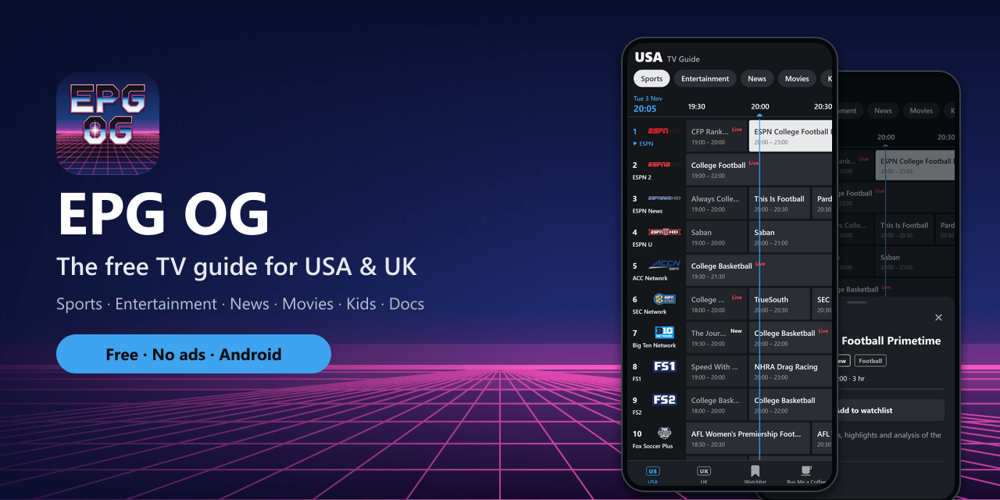
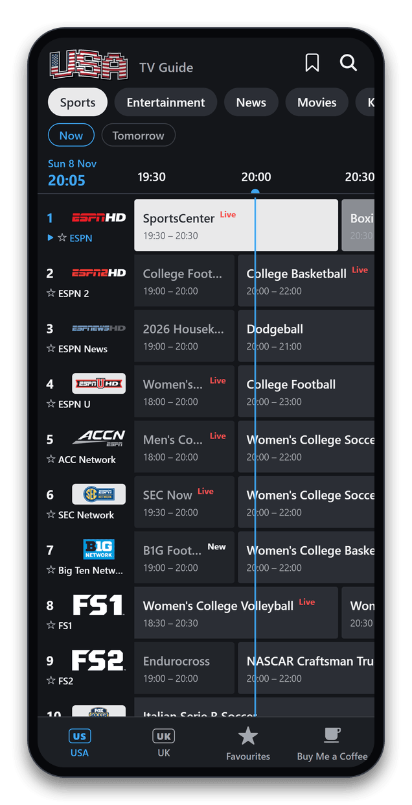
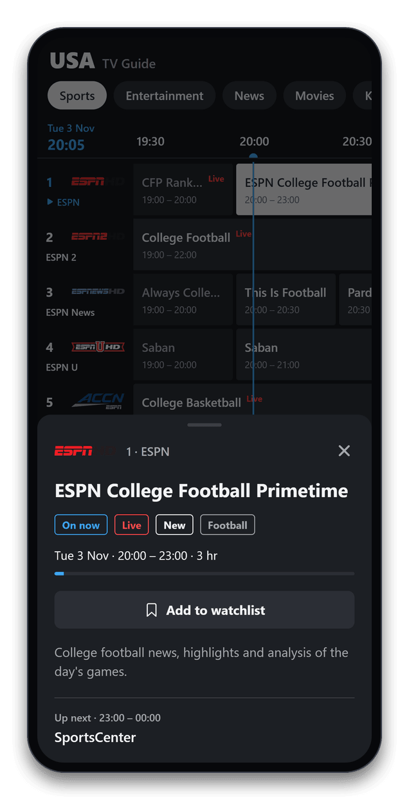
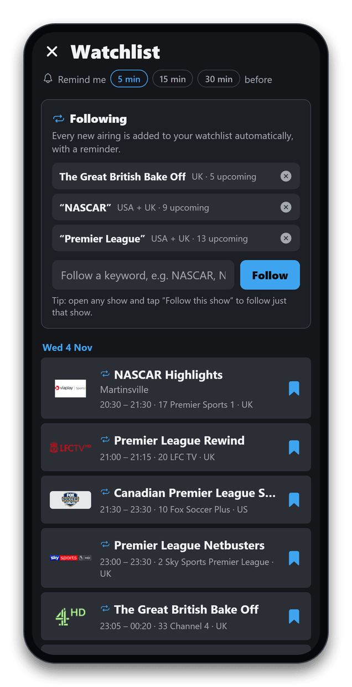
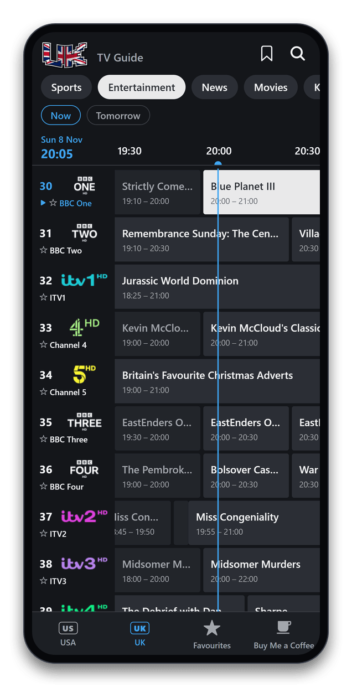
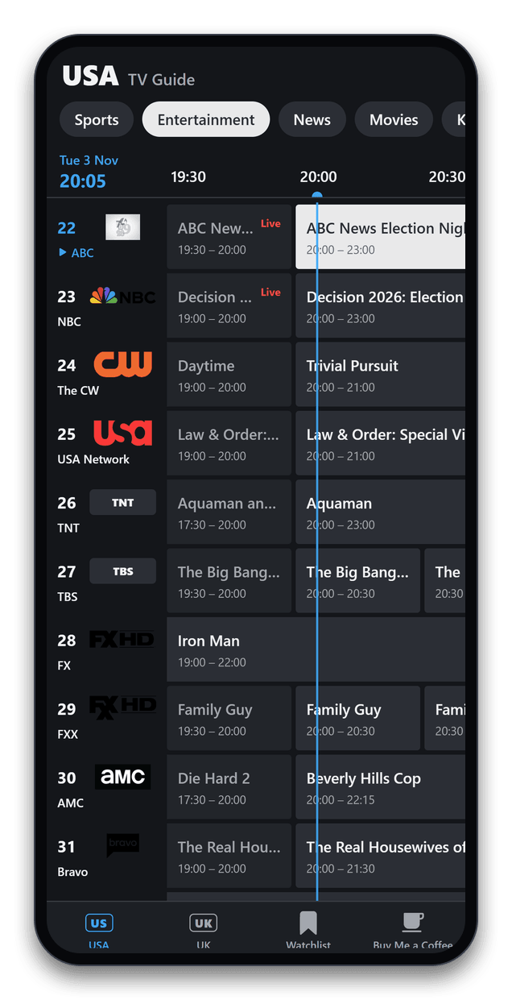
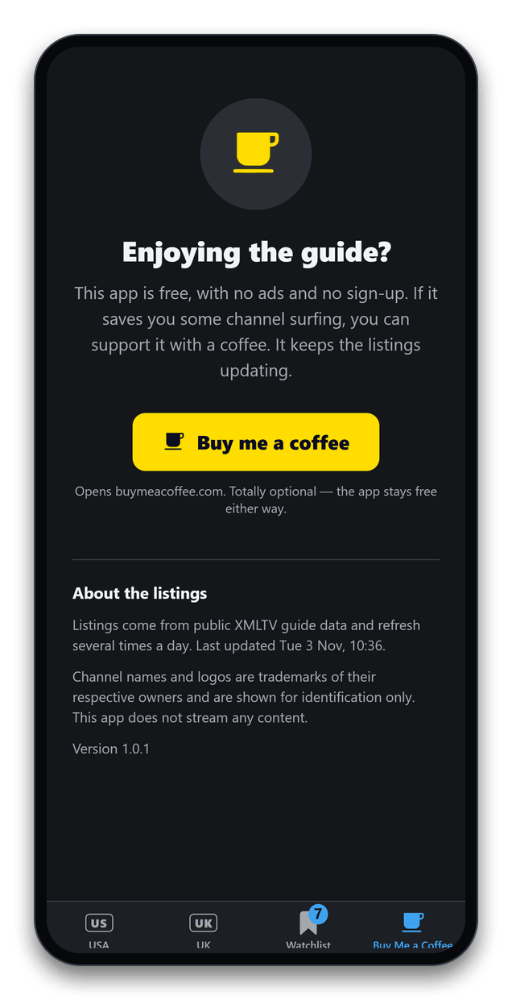
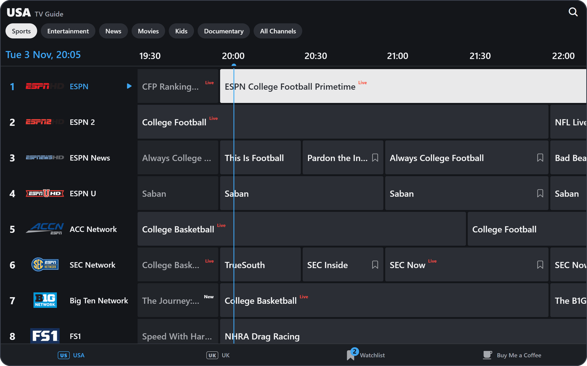

  

  
  
  
  
  

<h3 align="center">
  <a href="https://epgog.com">⬇️ Download for Android</a>
</h3>

---

**EPG OG** is a TV guide that looks and feels like the one on your TV box: a dark channel grid with logos, channel numbers and a live "now" line. It covers **around 190 USA and UK channels**, has a one-tap watchlist that reminds you before your show starts, and the listings refresh by themselves. It's free, with no ads, no account and no tracking.

<table>
  <tr>
    <td align="center" width="33%"> <b>Every channel at a glance</b> Live now-line, New and Live badges</td>
    <td align="center" width="33%"> <b>Tap any show</b> Description, progress and what's on next</td>
    <td align="center" width="33%"> <b>One-tap watchlist</b> Reminder 5 minutes before it starts</td>
  </tr>
  <tr>
    <td align="center"> <b>USA and UK</b> BBC, ITV, Channel 4, Sky and more</td>
    <td align="center"> <b>Sorted by category</b> Sports, Entertainment, News, Movies, Kids, Docs</td>
    <td align="center"> <b>Free for everyone</b> No ads; an optional coffee keeps it going</td>
  </tr>
</table>

## Big-screen mode

Turn your phone sideways or use a tablet, and you get the full TV-style grid.

  

## Features

- 📺 **USA and UK guides**, each split into Sports, Entertainment, News, Movies, Kids and Documentary, plus All Channels
- 🔁 **Follow shows and sports.** Tap "Follow this show", or follow a keyword like *NASCAR*, *NFL* or *Premier League*, and every new airing is added to your watchlist with a reminder
- 🔎 **Search** shows, teams and channels across the USA and UK
- 🔖 **Watchlist with reminders.** Tap the bookmark on any upcoming show and get a notification 5 minutes before it starts
- ⏱️ **Live now-line** across the grid, with **New** and **Live** badges on shows
- 📝 **Show details**: description, running time, a progress bar for what's on now, and what's up next
- 🔄 **Always fresh.** Listings update every 6 hours, and the app updates itself with fixes and new features
- 🔒 **Private.** No account, no ads, no tracking. Your watchlist stays on your phone ([privacy policy](https://epgog.com/privacy.html))

## Channels

<b>🇺🇸 USA: 98 channels</b>

| Category | Channels |
| --- | --- |
| **Sports** (21) | ESPN, ESPN 2, ESPN News, ESPN U, ACC Network, SEC Network, Big Ten Network, FS1, FS2, NFL Network, NBA TV, MLB Network, NHL Network, and more |
| **Entertainment** (25) | ABC, NBC, The CW, USA Network, TNT, TBS, FX, AMC, Bravo, Comedy Central, and more |
| **News** (14) | CNN, Fox News, MS NOW, CNBC, Fox Business, Bloomberg, NewsNation, and more |
| **Movies** (15) | HBO, Cinemax, The Movie Channel, Starz, TCM, and more |
| **Kids** (11) | Disney Channel, Disney Junior, Disney XD, Nickelodeon, Nick Jr., Cartoon Network, and more |
| **Documentary** (12) | Discovery, History, Nat Geo, Nat Geo Wild, Animal Planet, Smithsonian, and more |

<b>🇬🇧 UK: 95 channels</b>

| Category | Channels |
| --- | --- |
| **Sports** (21) | Sky Sports Main Event, Premier League, Football, Cricket, F1, Golf, TNT Sports 1–4, Premier Sports, and more |
| **Entertainment** (24) | BBC One, BBC Two, ITV1, Channel 4, Channel 5, E4, Sky Atlantic, Dave, and more |
| **News** (11) | BBC News, Sky News, GB News, CNN International, Al Jazeera, Bloomberg, and more |
| **Movies** (14) | Sky Cinema Premiere, Hits, Action, Comedy, Family, Thriller, Film4, and more |
| **Kids** (10) | CBBC, CBeebies, Sky Kids, Cartoon Network, Cartoonito, Nickelodeon, and more |
| **Documentary** (15) | Discovery, Nat Geo, Sky Documentaries, Sky Nature, Sky History, and more |

## Install on Android

1. On your phone, open **[epgog.com](https://epgog.com)** and tap **Download for Android**.
2. Open the downloaded file. If asked, allow your browser to install apps.
3. Tap **Install**. If Play Protect warns about an unknown developer, choose **More details → Install anyway**.

When a new version comes out, the app shows a banner. Tap it to download the update.

An iPhone version isn't available yet.

## Support the app

EPG OG is free and always will be. If it saves you some channel surfing, you can [buy me a coffee ☕](https://buymeacoffee.com/epgog). It helps keep the listings running.

Missing a channel, found a bug or have an idea? Email **[support@epgog.com](mailto:support@epgog.com)** or [open an issue](https://github.com/EPG-OG/epg-og/issues).

## Disclaimer

EPG OG shows TV listings only; it doesn't stream any content. Listings come from public XMLTV guide data. Channel names and logos are trademarks of their respective owners and are shown for identification only. EPG OG isn't affiliated with or endorsed by any broadcaster.

---

Building or contributing? See the <a href="docs/DEVELOPMENT.md">developer guide</a>.
