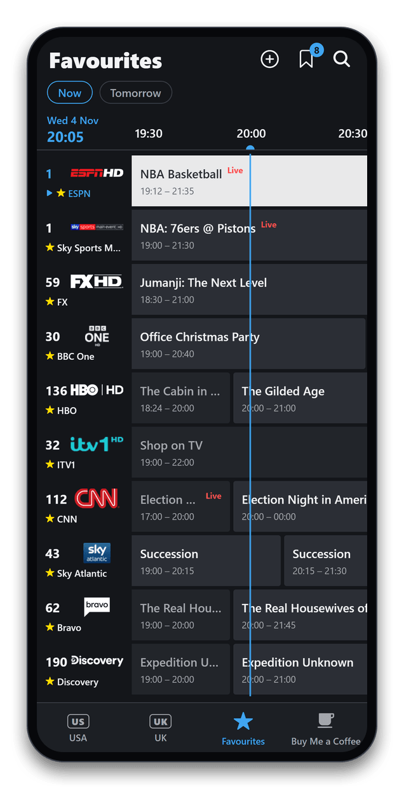
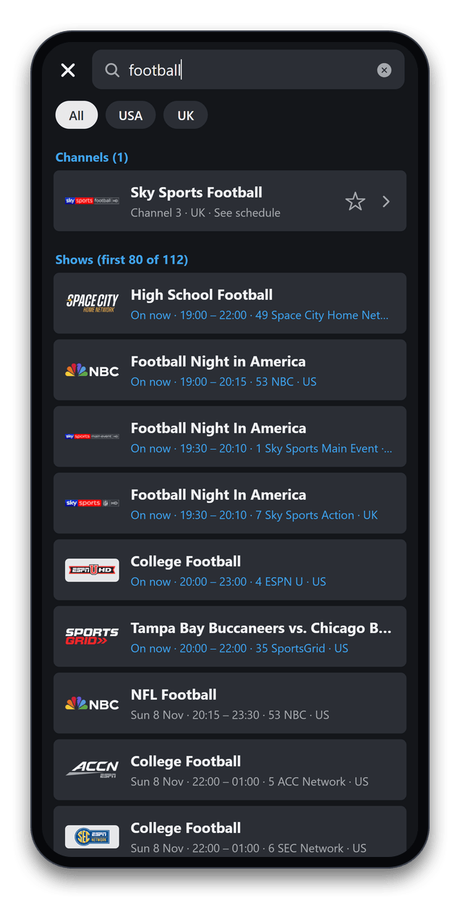

  

  
  
  
  
  

<h3 align="center">
  <a href="https://epgog.com">⬇️ Download for Android</a>
</h3>

---

**EPG OG** is a TV guide that looks and feels like the one on your TV box: a dark channel grid with logos, channel numbers and a live "now" line. It covers **over 400 USA and UK channels**, lets you build your own guide of **favourites**, **search** everything and **follow** your favourite shows and sports so you never miss them, and the listings refresh by themselves. It's free, with no ads, no account and no tracking.

<table>
  <tr>
    <td align="center" width="33%"> <b>Every channel at a glance</b> Jump to Now, Tonight or Tomorrow</td>
    <td align="center" width="33%"> <b>🆕 Your favourites</b> Tap a channel's name to add it</td>
    <td align="center" width="33%"> <b>🆕 Show artwork</b> Follow a show and every new airing is added for you</td>
  </tr>
  <tr>
    <td align="center"> <b>Watchlist that fills itself</b> Follow keywords like NASCAR or Premier League</td>
    <td align="center"> <b>USA and UK</b> BBC, ITV, Channel 4, Sky and more</td>
    <td align="center"> <b>Search everything</b> Shows, teams and channels, USA and UK</td>
  </tr>
</table>

## 🆕 What's new

- **Favourites:** tap any channel's name to add it to your own guide, with USA and UK channels side by side. Hold and drag to put them in any order, and swipe left to remove one.
- **Move your tabs:** hold and drag a tab at the bottom to put it where you want it.
- **Now, Tonight, Tomorrow:** jump straight there. The guide now runs two days ahead.
- **Show artwork** in the details of nearly every show, and paid programming is dimmed so real shows stand out.
- **Works offline:** the latest listings are saved on your phone, so the guide opens quickly and still works with no signal.

## Never miss your shows

- **Follow this show:** open any show and tap **Follow this show**. Every future airing goes straight onto your watchlist, with a reminder 5, 15 or 30 minutes before it starts.
- **Follow a keyword:** tap the bookmark at the top of the guide and type something like **NASCAR**, **NFL**, **Premier League** or **Bake Off**. Every matching game, race or episode on any channel, in the USA or UK, is added automatically.
- **Search:** tap 🔍 at the top of the guide to find any show, team or channel. Tap a channel to see its full schedule, or a show to save or follow it.

## Big-screen mode

Turn your phone sideways or use a tablet, and you get the full TV-style grid.

  

## Features

- 📺 **USA and UK guides**, each split into Sports, Entertainment, News, Movies, Kids, Documentary and Music, plus Spanish (USA), South Asian (UK) and All Channels
- ⭐ **Favourites.** Tap a channel's name to add it to your own guide, hold and drag to reorder, swipe left to remove. You can drag the tabs into the order you like too
- 🔁 **Follow shows and sports.** Tap "Follow this show", or follow a keyword like *NASCAR*, *NFL* or *Premier League*, and every new airing is added to your watchlist with a reminder
- 🔎 **Search** shows, teams and channels across the USA and UK
- 🔖 **Watchlist with reminders.** Tap the bookmark on any upcoming show and get a notification 5, 15 or 30 minutes before it starts
- ⏱️ **Live now-line** across the grid, with **New** and **Live** badges on shows
- 📝 **Show details**: artwork, description, running time, a progress bar for what's on now, and what's up next
- 🔄 **Always fresh.** Listings update every 6 hours and are saved for offline use, and the app updates itself with fixes and new features
- 🔒 **Private.** No account, no ads, no tracking. Your watchlist and favourites stay on your phone ([privacy policy](https://epgog.com/privacy.html))

## Channels

<b>🇺🇸 USA: 242 channels</b>

| Category | Channels |
| --- | --- |
| **Sports** (52) | ESPN, ESPN 2, ESPN News, ESPN U, ACC Network, SEC Network, Big Ten Network, FS1, FS2, NFL Network, NBA TV, MLB Network, NHL Network, and more |
| **Entertainment** (59) | ABC, NBC, The CW, USA Network, TNT, TBS, FX, AMC, Bravo, Comedy Central, and more |
| **News** (24) | CNN, Fox News, MS NOW, CNBC, Fox Business, Bloomberg, NewsNation, and more |
| **Movies** (38) | HBO, Cinemax, The Movie Channel, Starz, TCM, and more |
| **Kids** (16) | Disney Channel, Disney Junior, Disney XD, Nickelodeon, Nick Jr., Cartoon Network, and more |
| **Documentary** (27) | Discovery, History, Nat Geo, Nat Geo Wild, Animal Planet, Smithsonian, and more |
| **Music** (13) and **Spanish** (13) | Music and Spanish-language channels |

<b>🇬🇧 UK: 163 channels</b>

| Category | Channels |
| --- | --- |
| **Sports** (29) | Sky Sports Main Event, Premier League, Football, Cricket, F1, Golf, TNT Sports 1–4, Premier Sports, and more |
| **Entertainment** (54) | BBC One, BBC Two, ITV1, Channel 4, Channel 5, E4, Sky Atlantic, Dave, and more |
| **News** (14) | BBC News, Sky News, GB News, CNN International, Al Jazeera, Bloomberg, and more |
| **Movies** (16) | Sky Cinema Premiere, Hits, Action, Comedy, Family, Thriller, Film4, and more |
| **Kids** (11) | CBBC, CBeebies, Sky Kids, Cartoon Network, Cartoonito, Nickelodeon, and more |
| **Documentary** (24) | Discovery, Nat Geo, Sky Documentaries, Sky Nature, Sky History, and more |
| **Music** (5) and **South Asian** (10) | Music and South Asian channels |

## Install on Android

> 🛡️ **Only download EPG OG from [epgog.com](https://epgog.com) or this repo's [Releases](https://github.com/EPG-OG/epg-og/releases).** EPG OG is a TV guide only: it never plays streams, sells subscriptions or asks for payment details. Copies from anywhere else may be modified or unsafe.

1. On your phone, open **[epgog.com](https://epgog.com)** and tap **Download for Android**.
2. Open the downloaded file. If asked, allow your browser to install apps.
3. Tap **Install**. If Play Protect warns about an unknown developer, choose **More details → Install anyway**.

When a new version comes out, the app shows a banner. Tap it to download the update.

**Using [Obtainium](https://obtainium.imranr.dev)?** Tap **Get it on Obtainium** on [epgog.com](https://epgog.com), or in Obtainium tap **Add App** and paste `https://github.com/EPG-OG/epg-og`. You'll get updates straight from our GitHub releases.

An iPhone version isn't available yet.

## Support the app

EPG OG is free and always will be. If it saves you some channel surfing, you can [buy me a coffee ☕](https://buymeacoffee.com/epgog). It helps keep the listings running.

Missing a channel, found a bug or have an idea? Email **[support@epgog.com](mailto:support@epgog.com)** or [open an issue](https://github.com/EPG-OG/epg-og/issues).

## Disclaimer

EPG OG shows TV listings only; it doesn't stream any content. Listings come from public XMLTV guide data. Channel names and logos are trademarks of their respective owners and are shown for identification only. EPG OG isn't affiliated with or endorsed by any broadcaster.

---

Building or contributing? See the <a href="docs/DEVELOPMENT.md">developer guide</a>.
